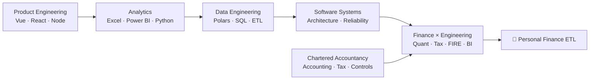

# Shan.tk 👋

### Sudharshan TK · Chartered Accountant × Data & Software Engineer

**Finance → Data → Systems → Decisions**

I build local-first systems that turn messy financial and operational evidence into  
**reconciled state, reliable data infrastructure, and decision-ready analytics**.

 

---

## 🧭 How the side quests became systems

I started with the web, moved into full-stack products, found Python through analytics, then kept following the data until scripts became pipelines and pipelines became systems.

In parallel, Chartered Accountancy kept teaching me to ask annoying-but-useful questions:

> **Where did this number come from? What evidence supports it? Does it reconcile? What changed? Can I explain it later?**

Eventually finance and engineering stopped being separate tracks.

*Appo dhaan main picture start aachu.* 🔥

I like to think the progression has a little **Thalaivar entry energy**: the setup looks reasonable, the background score slowly gets louder, and suddenly the side project has a Control Plane.

**Build products → engineer data → model semantics → reconstruct financial truth → support decisions.**

---

## 🚀 The projects that got out of hand

<table>
<tr>
<td width="50%" valign="top">

### 💸 [Personal Finance ETL](https://github.com/tks18/personal-finance-etl)

**The side project that forgot it was a side project.**

I wanted one reliable view of my finances.

An unreasonable number of commits later, I somehow had a local-first financial data platform spanning household finance, investments, FIFO accounting, broker reconciliation, multi-currency analytics, tax evidence, wealth, FIRE, Power BI, CLI, and Desktop.

`Python` · `Polars` · `DuckDB` · `SQLite` · `Power BI`

**Finance**  
`FIFO` · `XIRR` · `FX Attribution` · `Tax` · `Wealth` · `Monte Carlo FIRE`

**Engineering**  
`ETL` · `Data Contracts` · `Lineage` · `Typed Architecture` · `Recovery` · `Testing`

**Product**  
`CLI` · `Desktop` · `Power BI` · `PyPI`

Somewhere around the SQLite Control Plane, I accepted that this was no longer a budgeting script. 😂

*Simple-ah start pannadhu... konjam mass-ah poiduchu.* 🔥

**[Repo](https://github.com/tks18/personal-finance-etl) · [Wiki](https://github.com/tks18/personal-finance-etl/wiki) · [Docs](https://github.com/tks18/personal-finance-etl/blob/master/docs/README.md) · [PyPI](https://pypi.org/project/personal-finance-etl/)**

</td>
<td width="50%" valign="top">

### ⚡ [PyQuery](https://github.com/PyQuery-HQ)

**Power Query instincts. Python-native machinery.**

I liked the transformation model. I also wanted Python, Polars, typed contracts, reusable execution, and fewer mysterious workbook rituals.

So PyQuery grew from workflow automation into reusable local-first data infrastructure.

If PFETL is my **Thalaivar-scale escalation arc**, PyQuery is the **Aandavar side of the brain**: keep experimenting with form, keep changing genres, keep asking whether the machinery itself can become the interesting part. 🎬

`Polars` · `Lazy Execution` · `Plugins` · `CLI` · `UI` · `API` · `SDK`

I prefer extracting reusable machinery from real workflows over collecting one-off scripts until the folder needs therapy.

**[HQ](https://github.com/PyQuery-HQ) · [Core](https://github.com/PyQuery-HQ/pyquery-core) · [Legacy](https://github.com/PyQuery-HQ/pyquery-legacy)**

</td>
</tr>
</table>

---

## 🧩 Other things I built

<table>
<tr>
<td width="50%" valign="top">

### 🧠 [pbi-to-sql](https://github.com/tks18/pbi-to-sql)

**Power BI semantics → relational state → local AI**

I reconstruct Power BI semantic models in SQL, then make that metadata useful for local semantic and RAG workflows.

`TMDL` · `SQLite` · `LangChain` · `Ollama`

</td>
<td width="50%" valign="top">

### 📊 [xlwings-excel-api](https://github.com/tks18/xlwings-excel-api)

**Python engineering where the users actually are.**

A modular Python × Excel × VBA framework for UDFs, query helpers, Power Query functions, and reusable analytics utilities.

`Python` · `xlwings` · `VBA` · `Power Query`

Sometimes the correct enterprise architecture really does begin with: **the users are in Excel.**

</td>
</tr>
<tr>
<td width="50%" valign="top">

### 🧪 [Shan's Dataverse](https://github.com/tks18/streamlit-synthetic-data)

**Analytics engineering turned into a product.**

A configurable synthetic-data workbench for finance and operations POCs, dashboard testing, modelling, and prototyping without exposing real client data.

`Streamlit` · `Schema Builder` · `Vectorized Formulas` · `AST Validation`

</td>
<td width="50%" valign="top">

### 🧠 [open-memory-lane](https://github.com/tks18/open-memory-lane)

**A privacy-first systems side quest.**

My local, memory-conscious take on Windows Recall built around multimedia processing and resource constraints.

`Python` · `OpenCV` · `FFmpeg` · `SQLite`

My screenshots do not need a world tour either.

</td>
</tr>
</table>

Also in the analytics-tooling lane: <a href="https://github.com/tks18/xl-pq-handler"><b>xl-pq-handler</b></a>, where I turn Power Query assets into maintainable engineering artifacts instead of mysterious workbook archaeology.

---

## 🌱 The prequels

<table>
<tr>
<td width="50%" valign="top">

### 🌐 [gindex-v4](https://github.com/tks18/gindex-v4)

A Vue-based Google Drive indexing product with backend services, authentication, RBAC, MongoDB, media handling, and deployment tooling.

`Vue` · `Node.js` · `MongoDB` · `JWT`

**250+ stars · 230+ forks**

Open-source product engineering before data systems became the main plot.

</td>
<td width="50%" valign="top">

### 💰 Finance Manager

My earlier full-stack personal-finance application, built across **400+ commits**.

**[Frontend](https://github.com/tks18/finance-manager)** · `React` · `TypeScript` · `Redux`  
**[Backend](https://github.com/tks18/finance-manager-backend)** · `Node.js` · `Express` · `PostgreSQL`

This was where finance and product engineering first shared a codebase.

Personal Finance ETL is what happened after I kept asking harder questions of the data. 😅

*Idhu prequel. Main padam mela irukku.* 🎬

</td>
</tr>
</table>

---

## 🧠 Apparently I have a pattern

**Evidence > vibes.**  
If two states disagree, I model the disagreement. Making the dashboard prettier is not reconciliation. *Kanakku correct-ah irukkanum boss.* 😌

**Grain before metrics.**  
A perfect formula over the wrong object is still beautifully wrong.

**Local-first when the data deserves it.**  
My bank statements do not need a world tour.

**Different problems get different machinery.**  
Polars, stateful Python, Numba, SQL, BI, and UI all have jobs. I refuse to make one abstraction cosplay as all six.

This is probably the most **Aandavar-coded** part of how I build: I like changing the form when the problem changes instead of forcing every story into the same genre.

**Delete complexity when it stops paying rent.**  
I enjoy architecture. I do not collect it.

Mass is great. Unnecessary runtime is not. Even the hero needs an editor. 😂

---

## 🧰 The toolbox

| Lane | What usually shows up |
|---|---|
| **Finance** | Accounting · controls · tax · FIFO · XIRR · FX · wealth · FIRE |
| **Data** | Python · Polars · DuckDB · SQLite · SQL · ETL · contracts · lineage |
| **Analytics** | Power BI · Power Query · Excel · DAX · semantic modelling |
| **Software** | Pydantic · APIs · CLI · desktop apps · TypeScript · React · Node.js |
| **Reliability** | Deterministic identity · provenance · recovery · testing · observability |
| **Semantic / local AI** | LangChain · RAG · Ollama · semantic metadata |

> **Chartered Accountancy is the domain lens, not a decorative credential.**  
> It shows up in how I think about evidence, reconciliation, controls, tax, grain, and whether a number can survive being asked **why**.

---

## 🏆 Tiny GitHub flex

Stats are fun. Projects are the receipts. Mass-ku proof venum. 🔥

---

## 🤝 Connect

 

**Finance gave me the questions. Data gave me the structure. Software engineering let me build the answers.**

*Class konjam. Mass konjam. Kanakku full-ah.* 🔥

