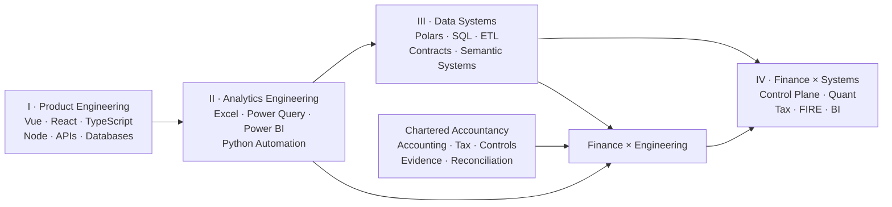
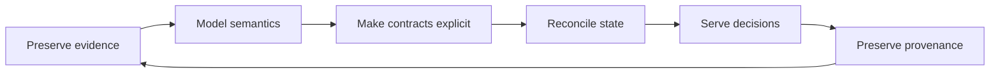

# Shan.tk 👋

### Sudharshan TK · Chartered Accountant × Data Engineer × Software Builder

**Finance → Data → Systems → Decisions**

I build local-first systems that turn messy financial and operational evidence into
**reconciled state, reusable data infrastructure, and decision-ready analytics**.

  

---

## 🧭 How the side quests became systems

I started by building for the web, moved into full-stack products, found Python through analytics,
then kept following the data until the scripts became pipelines and the pipelines became systems.

In parallel, Chartered Accountancy kept teaching me to ask annoying-but-useful questions:

**Where did this number come from? What evidence supports it? Does it reconcile? What changed? Can I explain it later?**

Eventually finance and engineering stopped being separate tracks.

**Build products → engineer data → model semantics → reconstruct financial truth → support decisions.**

---

## 💎 Flagship Systems

<table>
<tr>
<td width="56%" valign="top">

### 💸 [Personal Finance ETL](https://github.com/tks18/personal-finance-etl)

**My flagship: a local-first financial data engineering and quantitative decision-support platform.**

I use it to turn fragmented household, broker, market, FX, and reference evidence into one
**reconciled financial state** that supports investment accounting, tax preparation, wealth analytics,
FIRE planning, and Power BI.

**Evidence & data engineering**  
`SQLite Control Plane` · `Artifact History` · `Persistent Bronze` · `Polars DAG` · `DuckDB` · `66 Data Contracts`

**Finance & Quant**  
`Deterministic IDs` · `FIFO Tax Lots` · `Realized Events` · `Broker Reconciliation` · `XIRR` · `Shadow Benchmarks` · `FX Attribution`

**Tax, wealth & planning**  
`Tax Evidence` · `After-Tax Wealth` · `Cash-Flow Reconciliation` · `Markov Regimes` · `Monte Carlo FIRE`

**Reliability & product**  
`Healing / Replay` · `Forensic Logging` · `Snapshot / Restore` · `CLI` · `Desktop` · `Power BI`

The fun part is that none of those subsystems gets to invent its own financial truth. 😄

**Explore:** [Repo](https://github.com/tks18/personal-finance-etl) ·
[Wiki](https://github.com/tks18/personal-finance-etl/wiki) ·
[Docs](https://github.com/tks18/personal-finance-etl/blob/master/docs/README.md) ·
[PyPI](https://pypi.org/project/personal-finance-etl/)

</td>
<td width="44%" valign="top">

### ⚡ [PyQuery](https://github.com/PyQuery-HQ)

**Python-native data execution systems.**

What began as Power Query-style transformation tooling evolved into reusable local-first
data infrastructure.

**Current core**  
`Polars-first` · `Typed` · `Deterministic` · `Plugin-driven`

**Platform evolution**  
`Lazy Execution` · `Large-file Workflows` · `CLI` · `UI` · `API` · `SDK`

**What it proves**  
I like extracting reusable machinery from real workflows instead of collecting one-off scripts until the folder needs therapy.

**Explore:** [HQ](https://github.com/PyQuery-HQ) ·
[Core](https://github.com/PyQuery-HQ/pyquery-core) ·
[Legacy](https://github.com/PyQuery-HQ/pyquery-legacy)

</td>
</tr>
</table>

---

## 🧩 Selected Engineering Work

Each of these sits on a different part of the path. I prefer that to a portfolio where twelve repositories all prove I can make another CRUD app.

<table>
<tr>
<td width="50%" valign="top">

### 🧠 [pbi-to-sql](https://github.com/tks18/pbi-to-sql)

**Power BI semantics → reusable data infrastructure**

Extracts a Power BI semantic model, reconstructs it in relational SQL, then layers local semantic/RAG capabilities over that state.

`TMDL` · `SQLite` · `LangChain` · `Ollama` · `RAG`

**Signal:** BI semantics, metadata engineering, relational reconstruction, local AI.

</td>
<td width="50%" valign="top">

### 📊 [xlwings-excel-api](https://github.com/tks18/xlwings-excel-api)

**Python engineering inside real Excel workflows**

A modular Python × Excel × VBA framework for UDFs, query helpers, Power Query functions, and reusable analytics utilities.

`Python` · `xlwings` · `VBA` · `Power Query` · `Power BI`

**Signal:** pragmatic automation where business workflows actually live.

</td>
</tr>
<tr>
<td width="50%" valign="top">

### 🧪 [Shan's Dataverse](https://github.com/tks18/streamlit-synthetic-data)

**Analytics engineering turned into a product**

An interactive synthetic-data workbench for finance and operations POCs, dashboard testing,
modelling, and prototyping without exposing real client data.

`Streamlit` · `Schema Builder` · `Vectorized Formulas` · `AST Validation` · `Reusable Profiles`

**Signal:** analytical product design, safe prototyping, configurable data generation.

</td>
<td width="50%" valign="top">

### 🧠 [open-memory-lane](https://github.com/tks18/open-memory-lane)

**A local systems-engineering side quest**

An open-source, memory-conscious take on Windows Recall built around local multimedia processing.

`Python` · `OpenCV` · `FFmpeg` · `SQLite` · `Local-first`

**Signal:** multimedia pipelines, resource constraints, privacy-first local systems.

</td>
</tr>
</table>

Also in the analytics-tooling lane:
<a href="https://github.com/tks18/xl-pq-handler"><b>xl-pq-handler</b></a>,
where Power Query assets become maintainable engineering artifacts instead of mysterious workbook archaeology.

---

## 🌱 Before the Data Engines

These projects matter because they show where the systems instincts came from.

<table>
<tr>
<td width="50%" valign="top">

### 🌐 [gindex-v4](https://github.com/tks18/gindex-v4)

A Vue-based Google Drive indexing product with backend services, authentication,
role-based access control, MongoDB, media handling, and deployment tooling.

`Vue` · `Node.js` · `MongoDB` · `JWT`

**250+ stars · 230+ forks**

Open-source product engineering before data systems became the main plot.

</td>
<td width="50%" valign="top">

### 💰 Finance Manager

A full-stack personal-finance application built across **400+ commits** in separate frontend and backend repositories.

**[Frontend](https://github.com/tks18/finance-manager)**  
`React` · `TypeScript` · `Redux`

**[Backend](https://github.com/tks18/finance-manager-backend)**  
`Node.js` · `Express` · `PostgreSQL` · `Sequelize` · `JWT`

This was where finance and product engineering first started sharing the same codebase.
Personal Finance ETL is what happened after I kept asking harder questions of the data. 😅

</td>
</tr>
</table>

---

## 🧠 The engineering pattern underneath the repos

Different projects, same recurring instincts:

- **Evidence over convenient assumptions.** If two states disagree, I would rather model the disagreement than silently make the dashboard prettier.
- **Grain before metrics.** A correct formula over the wrong financial object is still wrong.
- **Local-first when the data deserves it.** Personal and client-sensitive workflows do not need a cloud platform merely to feel sophisticated.
- **Different workloads deserve different compute models.** Vectorized ETL, stateful FIFO, numerical Monte Carlo, BI serving, and UI orchestration do not need one abstraction to win every argument.
- **Generalize from working systems.** I prefer abstractions extracted from real variation over frameworks designed for hypothetical futures.
- **Delete complexity when it loses its job.** Architecture should accumulate evidence, not barnacles.

---

## 🧰 What I Build With

| Capability | Toolkit / concepts |
|---|---|
| **Data engineering** | Python · Polars · DuckDB · SQLite · SQL · ETL · data contracts · lineage · reconciliation |
| **Analytics & BI** | Power BI · Power Query · Excel · DAX · semantic modelling · analytical marts |
| **Software & product engineering** | Pydantic · APIs · CLI · desktop apps · multiprocessing · TypeScript · React · Node.js |
| **Finance & Quant** | Accounting · controls · tax · FIFO · XIRR · portfolio analytics · FX attribution · Monte Carlo |
| **Reliability & architecture** | Deterministic identity · provenance · transactions · recovery · snapshot/restore · observability |
| **AI & semantic systems** | LangChain · RAG · Ollama · local LLM workflows · semantic metadata |

> **Chartered Accountancy is the domain lens, not a decorative credential.**
> It shows up in how I think about evidence, reconciliation, controls, tax, grain,
> financial semantics, and whether a number can survive being asked “why?”

---

## 🏆 Okay, a Little GitHub Flex

  

Stats are fun. Projects are the receipts.

---

## 🤝 Connect

  

**Finance gave me the questions. Data gave me the structure. Software engineering let me build the answers.**

